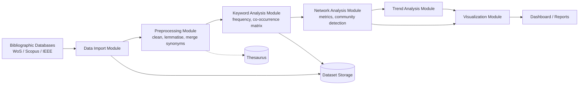
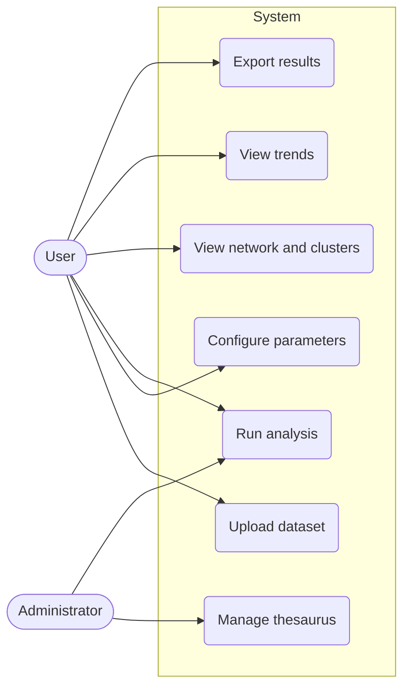
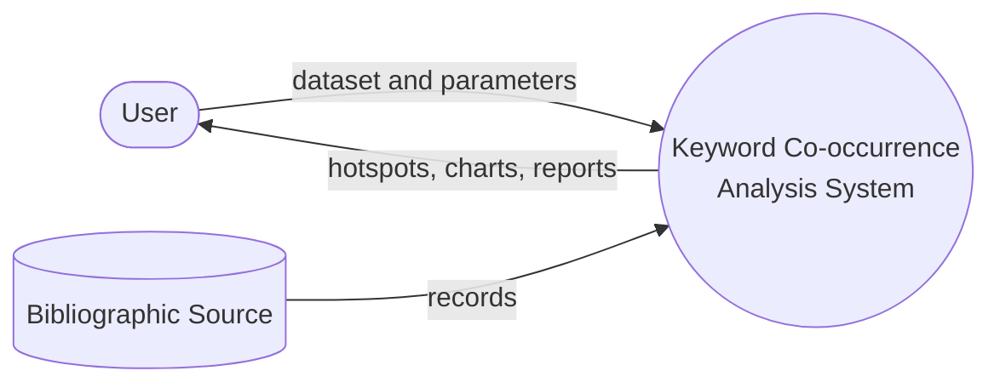
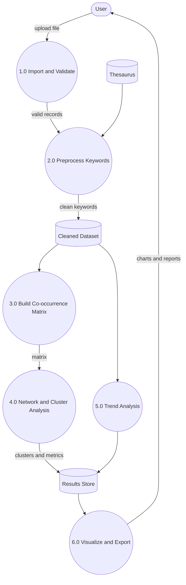
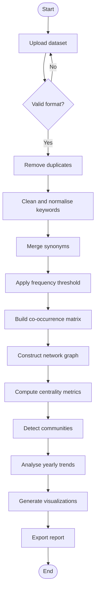
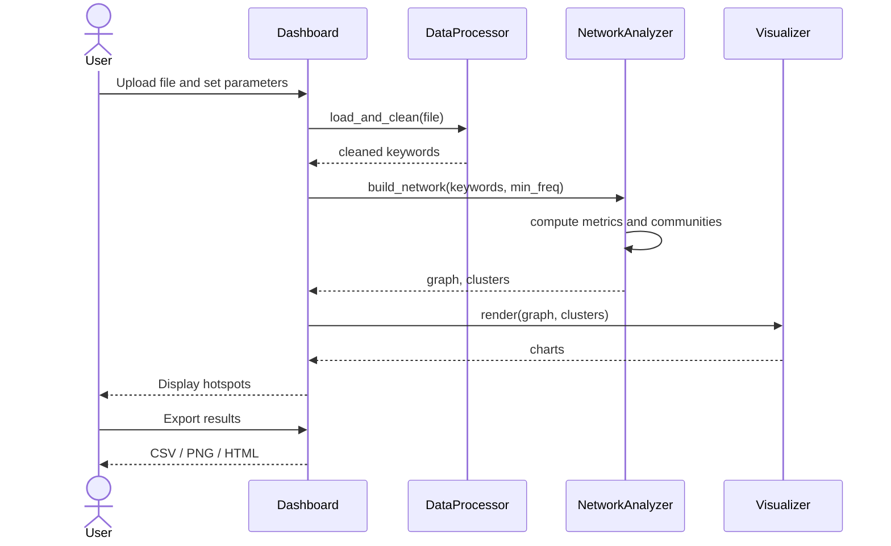
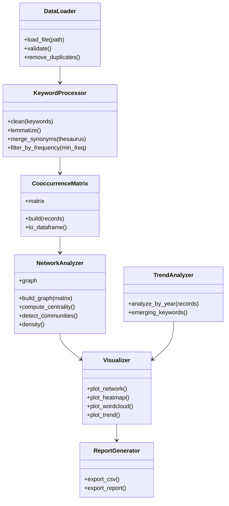
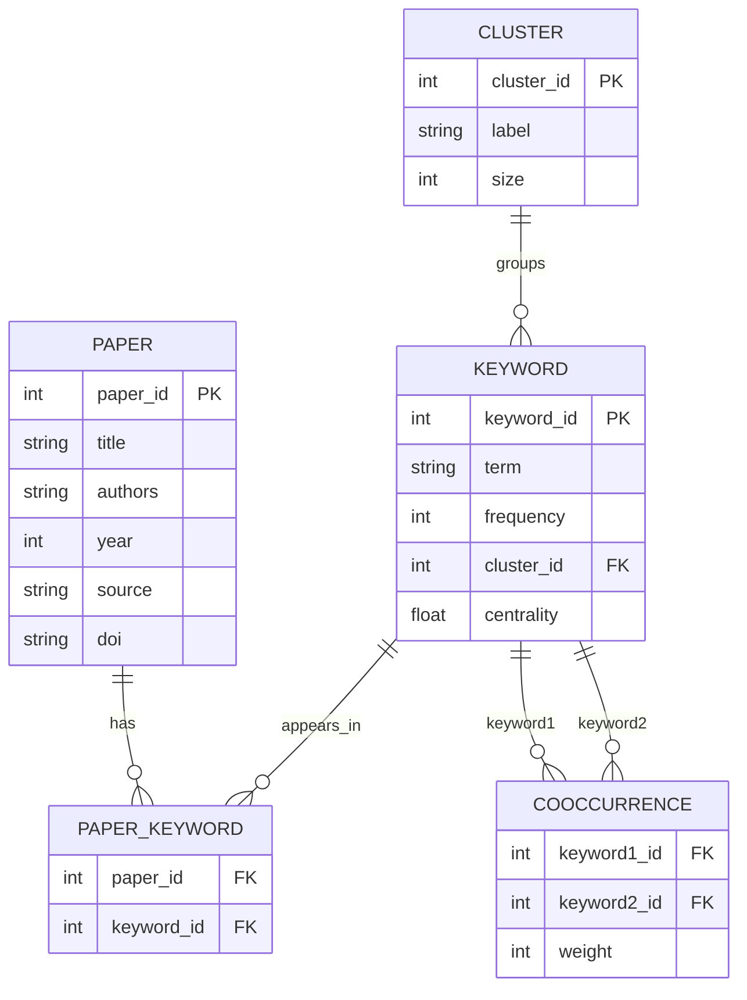

# System Diagrams

All diagrams use [Mermaid](https://mermaid.js.org/) and render directly on GitHub.

## 1. System Architecture

## 2. Use Case Diagram

## 3. Data Flow Diagram
### Level 0 (Context)

### Level 1

## 4. Activity Diagram

## 5. Sequence Diagram

## 6. Class Diagram

## 7. ER Diagram

