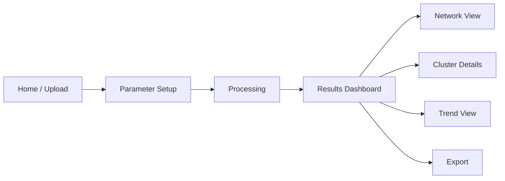

# UI Design

**Interface:** Web dashboard (Streamlit or similar). Wireframes below are low-fidelity layouts.

## 1. Design Principles
- Simple 4-step flow: Upload → Configure → Analyse → Explore
- Clean layout with a sidebar for parameters
- Interactive charts with tooltips and zoom
- Consistent colours: one colour per cluster

## 2. Screen Flow


## 3. Wireframes

### Screen 1: Home / Upload
```
+--------------------------------------------------------------+
|  Big Data Research Hotspot Analyzer                          |
+--------------------------------------------------------------+
|                                                              |
|     +--------------------------------------------+           |
|     |   Drag and drop file here                  |           |
|     |   (CSV, XLSX, BibTeX, TXT)                 |           |
|     |            [ Browse Files ]                |           |
|     +--------------------------------------------+           |
|                                                              |
|     Or  [ Use Sample Dataset ]                               |
|                                                              |
|     Records loaded: 0                      [ Next > ]        |
+--------------------------------------------------------------+
```

### Screen 2: Parameter Setup
```
+----------------------+---------------------------------------+
| PARAMETERS           |  DATA PREVIEW                         |
|                      |  Title | Year | Keywords              |
| Min keyword freq: [5]|  ------------------------------------ |
| Year range: [2012-2025]  Paper 1 | 2018 | big data; hadoop    |
| Keyword field:       |  Paper 2 | 2020 | cloud; iot          |
|  (o) Author keywords |  ...                                  |
|  ( ) Keywords Plus   |                                       |
| Use thesaurus: [x]   |                                       |
| Clustering: [Louvain]|                                       |
|                      |                                       |
| [ Run Analysis ]     |                                       |
+----------------------+---------------------------------------+
```

### Screen 3: Results Dashboard
```
+--------------------------------------------------------------+
| [Overview] [Network] [Clusters] [Trends] [Export]            |
+--------------------------------------------------------------+
| Papers: 8,420 | Keywords: 1,260 | Edges: 9,870 | Clusters: 7 |
+--------------------------------+-----------------------------+
|  Top 15 Keywords (bar chart)   |  Word Cloud                 |
|  big data ||||||||||||||||     |   (keyword sizes by freq)   |
|  machine learning ||||||||     |                             |
|  cloud computing |||||||       |                             |
+--------------------------------+-----------------------------+
|  Co-occurrence Heatmap (top 30 keywords)                     |
+--------------------------------------------------------------+
```

### Screen 4: Network View
```
+--------------------------------------------------------------+
| Filters: [Cluster v] [Min edge weight: 3] [Layout: Spring v] |
+--------------------------------------------------------------+
|                                                              |
|          (o)----(o)                (o)                       |
|         /  \    /  \              /  \                       |
|       (o)  (O)--(o)  (o)--------(O)  (o)                     |
|         \  /    \  /              \  /                      |
|          (o)----(o)                (o)                      |
|                                                              |
|   Node size = frequency | Colour = cluster | Edge = weight   |
+--------------------------------------------------------------+
```

### Screen 5: Cluster Details
```
+--------------------------------------------------------------+
| Cluster 1: Machine Learning and Analytics        [ Export ]  |
+--------------------------------------------------------------+
| Keyword            | Freq | Degree | Betweenness | Centrality |
| machine learning   | 520  | 85     | 0.12        | 0.45       |
| deep learning      | 310  | 60     | 0.08        | 0.38       |
| data mining        | 280  | 55     | 0.07        | 0.33       |
+--------------------------------------------------------------+
```

### Screen 6: Trend View
```
+--------------------------------------------------------------+
| Select keywords: [machine learning x] [blockchain x]  [+]    |
+--------------------------------------------------------------+
|  Freq                                                        |
|   |            ____/\                                        |
|   |      ___/--         \___                                 |
|   |  ___/                                                    |
|   +------------------------------------------ Year           |
|  Emerging: blockchain, edge computing   Declining: hadoop    |
+--------------------------------------------------------------+
```

## 4. UI Components
| Component | Purpose |
|-----------|---------|
| File uploader | Import dataset |
| Sidebar sliders and dropdowns | Set parameters |
| Tabs | Switch between result views |
| Metric cards | Show summary statistics |
| Interactive graph | Explore network |
| Data tables | Show keyword and cluster metrics |
| Download buttons | Export CSV, PNG, HTML |

## 5. Colour and Typography
- Background: white / light grey, accent: blue (#1F77B4)
- Cluster colours: categorical palette (tab10)
- Font: Sans-serif (Inter / Arial), 14 px body, 20 px headings
