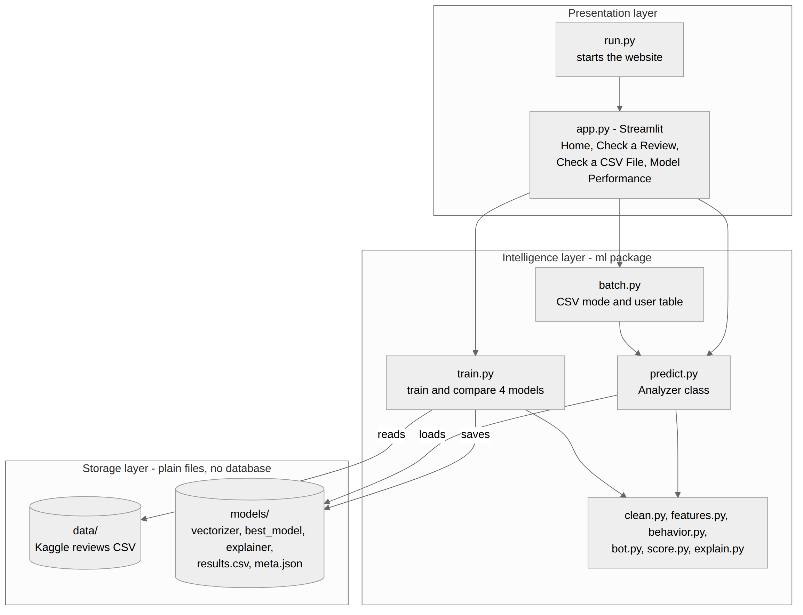

# AI-Powered Fake Product Review Detection (TrustLens)

> Major Project - Design Phase

Fake reviews mislead buyers, and bots make them look real. **TrustLens** checks each review and each user and gives a **trust score from 0 to 100** with clear reasons. It combines a machine-learning text model with simple behaviour rules (reviews per day and account age).

## Project details

| | |
|---|---|
| **Project title** | AI-Powered Fake Product Review Detection (TrustLens) |
| **Project domain** | AI / ML |

### Team members
| Name | Roll number |
|---|---|
| Mohammed Awaiz Ahmed | 160923750094 |
| Mohammed Talha | 160923750116 |
| Md Shahid Ali | 160923750081 |

## Design-phase documents

| # | Document | What it contains |
|---|---|---|
| 1 | [Problem Statement](docs/01_Problem_Statement.md) | Background, problem, objectives, scope |
| 2 | [Software Requirements Specification (SRS)](docs/02_SRS.md) | Functional and non-functional requirements, use cases, traceability |
| 3 | [System Architecture](docs/03_System_Architecture.md) | Layers, modules, technology stack, design decisions |
| 4 | [Data and ML Design](docs/04_Data_and_ML_Design.md) | Dataset, pipeline, TF-IDF, four models, evaluation |
| 5 | [Trust Score and Bot Design](docs/05_Trust_Score_and_Bot_Design.md) | Behaviour risk, trust formulas, explanation design |
| 6 | [UML and Data Flow](docs/06_UML_and_Data_Flow.md) | Use case, data flow, class and sequence diagrams |
| 7 | [UI Design](docs/07_UI_Design.md) | Page navigation and wireframes |

All diagram images are in [`diagrams/`](diagrams/). Their editable sources (Mermaid) are in `diagrams/src/`.

## Design at a glance



**Pipeline:** review text -> clean -> TF-IDF numbers -> best of 4 models gives the fake chance -> mix with behaviour risk -> trust score 0-100 -> explanation (highlighted words).

| Score | Review level | User status |
|---|---|---|
| 70 - 100 | Trusted | Looks human |
| 40 - 69 | Needs a check | Suspicious |
| 0 - 39 | Likely fake or bot | Bot-like |

## Key features
- Fake or genuine decision from the review text
- Manual review box and CSV file upload
- Bot detection from reviews per day and account age
- Trust score for every review and every user
- Explanation: reasons list and red/green highlighted words
- Streamlit website with four pages; no login and no database

## Technology
Python, Streamlit, scikit-learn, XGBoost, pandas, Plotly, joblib.

## Implementation prototype
The working prototype code is in this repository (files outside `docs/` and `diagrams/`). To try it, from the project folder:

```
pip install -r requirements.txt
python app.py
```
The website opens in the browser. The model must be trained once (button on the website, or `python -m ml.train`) using the Kaggle *Fake Reviews Dataset* in the `data/` folder.

Model results will be added in the testing phase.

## Limitations (known at design time)
1. The dataset's fake reviews are computer-generated; human-written fakes may be harder.
2. Behaviour rules and score weights are design choices, not learned from data.
3. English only; TF-IDF does not understand meaning or sarcasm.

## Future scope
Test on human-written fake reviews, learn the score weights from data, try deep models such as BERT, add SHAP or LIME, and use a live behaviour data source.
