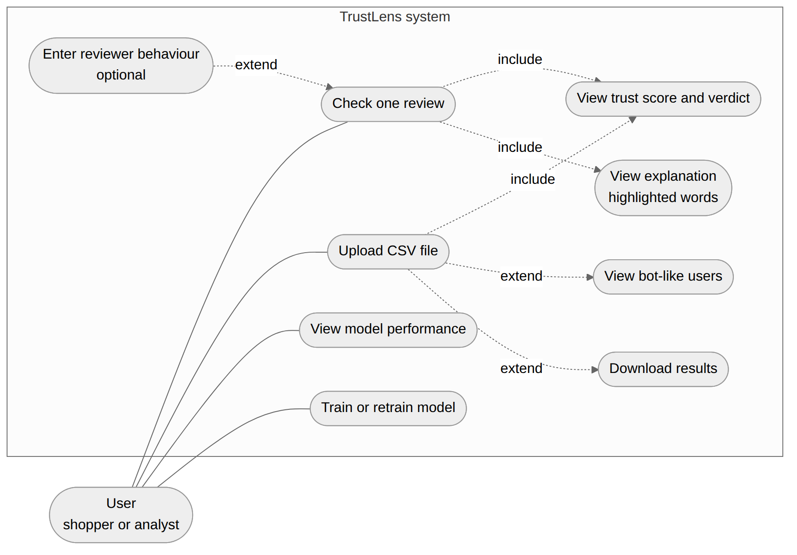

# 2. Software Requirements Specification (SRS)

**Project:** AI-Powered Fake Product Review Detection (TrustLens)

## 2.1 Introduction

### 2.1.1 Purpose
This document lists what TrustLens must do (functional requirements) and how well it must do it (non-functional requirements).

### 2.1.2 Scope
TrustLens is a stand-alone website that runs on the user's own computer. It detects fake reviews, bot-like users, and gives a trust score with reasons. See `01_Problem_Statement.md`.

### 2.1.3 Definitions
| Term | Meaning |
|---|---|
| Fake review | A review that was not written from real use of the product. In the dataset it is labelled CG (computer generated). |
| Genuine review | A real review, labelled OR (original) in the dataset. |
| TF-IDF | A way to turn words into numbers. Words special to a review get high values. |
| F1 score | A score that balances precision and recall. |
| Trust score | A number from 0 (not trusted) to 100 (trusted). |
| Behaviour risk | A number from 0 to 1 from reviews per day and account age. |
| Bot-like | A user whose behaviour and reviews look automated. |

### 2.1.4 References
1. Rashmi R. et al., "Multimodal machine learning framework for fake review detection", *Int. J. Electrical and Computer Engineering*, vol. 16, no. 2, pp. 991-1001, 2026.
2. Giriprasath K. et al., "ReviewGuard: Real-Time Detection of Fake Online Reviews", *COMPUTATIA 2026*, Atlantis Highlights in Intelligent Systems 18.
3. Shajalal Md. et al., "Do the Explanations Make Sense? Explainable Fake Review Identification and Users' Perspectives on Explanations", CEUR Workshop Proceedings, vol. 4017, 2025.
4. Kaggle, "Fake Reviews Dataset" (columns: category, rating, label, text_).

## 2.2 Overall description

### 2.2.1 Product perspective
A self-contained Python application. A Streamlit website (presentation layer) calls the `ml` package (intelligence layer), which reads and writes plain files (storage layer). See `03_System_Architecture.md`.

### 2.2.2 Product functions (summary)
Check one review, check a CSV file, detect bot-like users, explain results, show model performance, train the model.

### 2.2.3 User classes
| User | Needs |
|---|---|
| Shopper | Quickly see if a review can be trusted, and why. |
| Seller or moderator | Check many reviews and find suspicious users. |
| Student or examiner | See how the models compare and retrain them. |

### 2.2.4 Operating environment
Windows, Linux or macOS with Python 3.9 or newer and a modern web browser. No internet connection is needed to use the system after installation.

### 2.2.5 Constraints
- No login and no database.
- Text model is trained on the Kaggle fake reviews dataset (English).
- Behaviour data is typed in (single review) or read from `user_id` and `date` columns (CSV).

### 2.2.6 Assumptions
- The dataset label is correct (CG = fake, OR = real).
- Behaviour rules (thresholds and weights) are design choices and are not learned from data.

## 2.3 Functional requirements

| ID | Requirement | Objective | Module |
|---|---|---|---|
| FR-01 | The system shall accept one review typed or pasted by the user. | O1, O5 | `app.py` |
| FR-02 | The system shall offer a fake-style and a real-style example review. | O5 | `app.py` |
| FR-03 | The system shall accept optional reviewer behaviour: reviews in the last 24 hours (0 to 30) and account age in days (0 to 365). | O2 | `app.py` |
| FR-04 | The system shall classify a review as **Fake** (fake probability 0.5 or more) or **Genuine**. | O1 | `ml/predict.py` |
| FR-05 | The system shall compute a review trust score from 0 to 100 and a level: Trusted (70-100), Needs a check (40-69), Likely fake or bot (0-39). | O3 | `ml/score.py` |
| FR-06 | When behaviour is known, the system shall compute a user trust score and a status: Looks human, Suspicious or Bot-like. | O2, O3 | `ml/bot.py`, `ml/behavior.py` |
| FR-07 | The system shall explain each result: a list of reasons, a chart of the most influential words, the review with fake-like words in red and real-like words in green, and the score formula with its values. | O4 | `ml/explain.py`, `app.py` |
| FR-08 | The system shall accept a CSV file with a review text column (`review_text`, `text_`, `text` or `review`) and optional `user_id`, `date` and `label` columns. | O5 | `ml/batch.py` |
| FR-09 | The user shall be able to limit the number of reviews checked (100 to 10,000, default 2,000). | O5 | `app.py` |
| FR-10 | For a CSV, the system shall show totals (genuine, fake, average trust), three charts, a filterable and searchable review table, and download buttons. | O3, O5 | `app.py` |
| FR-11 | When `user_id` exists, the system shall count each user's reviews per day (busiest day if `date` exists, otherwise total in file) and show a users table, most suspicious first. | O2 | `ml/batch.py` |
| FR-12 | When a `label` column exists, the system shall report how often its verdict matches the label. | O1 | `ml/batch.py` |
| FR-13 | The system shall provide a demo CSV file. | O5 | `samples/` |
| FR-14 | The system shall train Logistic Regression, SVM, Random Forest and XGBoost on a balanced sample (up to 10,000 reviews), compare accuracy, precision, recall and F1 on a held-out 20 percent, and save the best model by F1. | O1 | `ml/train.py` |
| FR-15 | The system shall always save a Logistic Regression model for explanations. | O4 | `ml/train.py` |
| FR-16 | The system shall show the model comparison table, a bar chart and the confusion matrix of the best model. | O5 | `app.py` |
| FR-17 | The user shall be able to train (or train again) from the website and upload a dataset file. | O5 | `app.py` |
| FR-18 | The website shall start with one command (`python app.py`) and open in the browser by itself. | O6 | `app.py`, `run.py` |

## 2.4 External interface requirements

| Interface | Requirement |
|---|---|
| User interface | Streamlit website, left menu with four pages, works in light or dark theme. See `07_UI_Design.md`. |
| Software | Python, Streamlit, pandas, scikit-learn, XGBoost, Plotly, joblib. |
| Hardware | An ordinary laptop. No GPU. |
| Data input | Kaggle-style CSV for training. CSV or typed text for checking. |
| Data output | On-screen results; downloadable CSV files for reviews and users. |

## 2.5 Non-functional requirements

| ID | Quality | Requirement |
|---|---|---|
| NFR-01 | Usability | Plain-language labels and messages; every score comes with a reason. |
| NFR-02 | Performance | CSV reviews are scored in one batch (vectorised), not one by one, so that a few thousand reviews finish in seconds on an ordinary laptop (design target). |
| NFR-03 | Portability | Runs on Windows, Linux and macOS with Python 3.9+. |
| NFR-04 | Maintainability | UI code (`app.py`) is separate from ML code (`ml/`). Each ML step is in its own small file. |
| NFR-05 | Reproducibility | Fixed random seed (`random_state=42`) for sampling, splitting and models. |
| NFR-06 | Explainability | The explanation comes from Logistic Regression word weights, which are always saved. |
| NFR-07 | Privacy | All data stays on the user's computer. No external service is called. |
| NFR-08 | Simplicity | No login, no database, one command to start. |
| NFR-09 | Robustness | A missing model or dataset shows a clear message and a Train button instead of an error. |

## 2.6 Data requirements
See `04_Data_and_ML_Design.md` for the dataset schema, CSV input format and saved model files.

## 2.7 Use cases

| ID | Use case | Main steps |
|---|---|---|
| UC-01 | Check one review | Type review, (optional) set behaviour, press Check review, read score and reasons. |
| UC-02 | Check a CSV file | Upload file, press Analyze file, read totals, charts and tables, download results. |
| UC-03 | Find bot-like users | Upload CSV with `user_id`, open the Users and bots tab. |
| UC-04 | View model performance | Open Model Performance and read the table and confusion matrix. |
| UC-05 | Train the model | Press Train model now; wait for the progress bar. |

## 2.8 Traceability (objective to requirement to design)

| Objective | Requirements | Design document |
|---|---|---|
| O1 Fake text detection | FR-04, FR-12, FR-14 | `04_Data_and_ML_Design.md` |
| O2 Bot behaviour | FR-03, FR-06, FR-11 | `05_Trust_Score_and_Bot_Design.md` |
| O3 Trust score | FR-05, FR-06, FR-10 | `05_Trust_Score_and_Bot_Design.md` |
| O4 Explanation | FR-07, FR-15 | `05_Trust_Score_and_Bot_Design.md`, `06_UML_and_Data_Flow.md` |
| O5 Website | FR-01, FR-02, FR-08, FR-09, FR-10, FR-16, FR-17 | `07_UI_Design.md` |
| O6 Simple to run | FR-18, NFR-08 | `03_System_Architecture.md` |

## 2.9 Known limitations
1. The dataset's fake reviews are computer-generated; human-written fakes may be harder to detect.
2. Behaviour rules and score weights (70/30 and 50/50) are design choices, not learned from data.
3. English only; TF-IDF does not understand meaning or sarcasm.
4. Word highlighting shows which words the model used. It is a hint, not proof that a review is fake.
