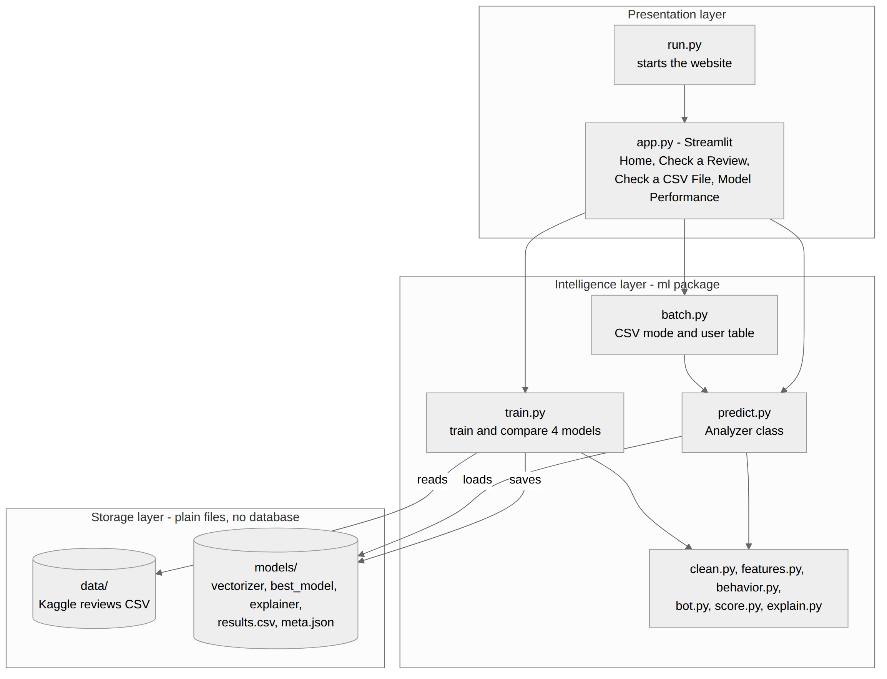
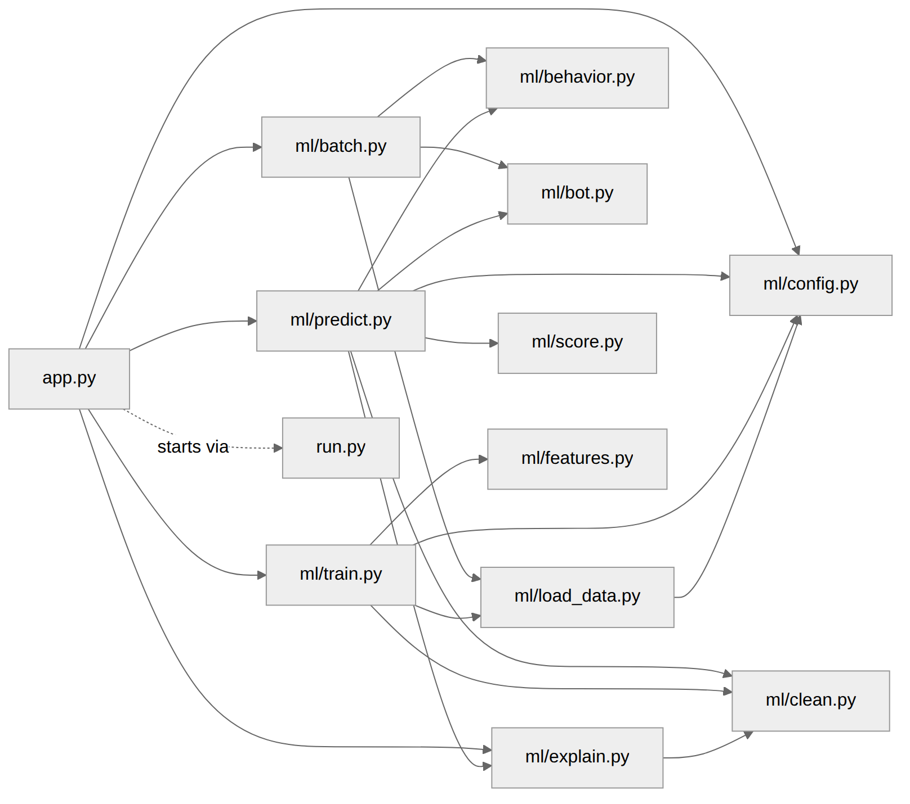

# 3. System Architecture

## 3.1 Overview
TrustLens has three layers. The screen (presentation) only shows pages. All learning and scoring is in the `ml` package (intelligence). Data and models are plain files (storage). There is **no database**.



## 3.2 Layers
| Layer | Files | Responsibility |
|---|---|---|
| Presentation | `app.py`, `run.py` | Show the four pages, take user input, show charts and tables. Start the website and open the browser. No ML maths here. |
| Intelligence | `ml/` package | Load data, clean text, build features, train models, predict, score, detect bots, explain. |
| Storage | `data/`, `models/` | Reviews CSV (input). Saved vectorizer, best model, explainer, results table and metadata (output). |

## 3.3 Modules
| Module | Responsibility |
|---|---|
| `ml/config.py` | All folder and file paths in one place. |
| `ml/load_data.py` | Read the CSV, convert labels (CG to 1, OR to 0), take up to 10,000 balanced reviews. |
| `ml/clean.py` | Clean one review: lowercase, remove HTML tags, keep letters only. |
| `ml/features.py` | TF-IDF vectorizer settings. |
| `ml/behavior.py` | Behaviour risk from reviews in 24 hours and account age. |
| `ml/score.py` | Review trust score (0-100) and level. |
| `ml/bot.py` | User trust score and bot status. |
| `ml/explain.py` | Word contributions, top words, highlighted review. |
| `ml/train.py` | Train four models, compare, save the best and the explainer. |
| `ml/predict.py` | `Analyzer` class: joins all steps for one review or many. |
| `ml/batch.py` | CSV mode: per-user counts, users table, optional accuracy against labels. |

### Module dependencies


## 3.4 Technology stack
| Technology | Used for |
|---|---|
| Python 3.9+ | Whole project |
| pandas | Reading CSV files and handling tables |
| scikit-learn | TF-IDF, Logistic Regression, SVM, Random Forest, metrics |
| XGBoost | XGBoost model |
| joblib | Saving and loading trained models |
| Streamlit | The website |
| Plotly | Gauge, bar, pie and histogram charts |

## 3.5 Design decisions
| Decision | Reason | Alternative (future) |
|---|---|---|
| Classical models with TF-IDF | Fast, light, and easy to explain. | Transformers such as BERT or DeBERTa: usually more accurate, but heavier and harder to explain. |
| Compare four models, keep best by F1 | Choose by evidence, not by guess. F1 balances precision and recall. | Hyper-parameter search, stacking. |
| Always save Logistic Regression | One readable weight per word gives the explanation. | SHAP or LIME. |
| Rule-based behaviour risk | The dataset has no user data to learn from. Rules are simple to explain. | A behaviour model learned from real reviewer data. |
| No login and no database | Keeps the system simple and easy to run and demonstrate. | Real behaviour data from a platform. |
| Streamlit | Pure Python; charts, file upload and download are built in. | Flask or a browser extension. |
| Plain files (joblib, csv, json) | Nothing to install or configure. | A model registry or database. |

## 3.6 Start-up design
1. The user runs `python app.py`.
2. `app.py` checks whether Streamlit is already running it. If not, it calls `launch()` in `run.py`.
3. `run.py` runs `python -m streamlit run app.py`. Streamlit starts a local server and opens the browser.
4. If no trained model exists, every page that needs it shows a **Train model now** button.

## 3.7 Folder structure
```
project root (the code in this repository)
├── app.py              Streamlit website
├── run.py              Starts the website, opens the browser
├── requirements.txt
├── .streamlit/config.toml
├── ml/                 All learning and scoring code
├── data/               Put the Kaggle CSV here
├── models/             Created when you train
├── samples/            Demo CSV for the CSV page
└── tests/              Unit tests for the rules and CSV logic
```
