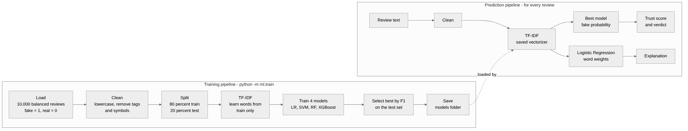

# 4. Data and Machine-Learning Design

## 4.1 Dataset
| Item | Detail |
|---|---|
| Source | Kaggle "Fake Reviews Dataset" (English product reviews) |
| Columns | `category`, `rating`, `label`, `text_` |
| Label | `CG` = computer generated (fake), `OR` = original (real) |
| Used by the model | `text_` (renamed `review_text`) and `label` |
| Sample used | Up to 10,000 reviews: 5,000 fake and 5,000 real, picked with `random_state=42` |
| Label conversion | fake = 1, real = 0 (other spellings such as fake, real, genuine, 1, 0 are also accepted) |

The dataset has **no user id and no date**. For this reason the behaviour part is rule-based and is not trained.

## 4.2 CSV input format for checking reviews
| Column | Required | Meaning |
|---|---|---|
| `review_text` (or `text_`, `text`, `review`) | Yes | The review text |
| `user_id` | No | Who wrote the review. Turns on bot detection. |
| `date` | No | Day of the review. With `user_id`, the busiest day per user is used. |
| `label` | No | If present (CG/OR or fake/real), the website reports how often its verdict matches. |

## 4.3 Pipeline

| Step | Design |
|---|---|
| Load | Read CSV, rename the text column, drop empty rows, convert labels, take a balanced sample. |
| Clean | Lowercase, remove HTML tags, keep only letters, collapse spaces. |
| Split | 80 percent train, 20 percent test, stratified (same fake/real ratio), `random_state=42`. |
| TF-IDF | Learn the vocabulary from the **train part only**, then apply it to the test part (avoids data leakage). |
| Train | Four models (table below). |
| Select | Highest F1 score on the test part. |
| Save | `models/` folder (table below). |

## 4.4 Features: TF-IDF settings
| Setting | Value | Meaning |
|---|---|---|
| `max_features` | 5000 | Keep the most useful 5,000 words or word pairs |
| `ngram_range` | (1, 2) | Single words and pairs such as "highly recommend" |
| `stop_words` | english | Ignore very common words |
| `min_df` | 2 | Ignore words found in fewer than 2 reviews |

## 4.5 Models
| Model | Settings | Role |
|---|---|---|
| Logistic Regression | `max_iter=1000` | Competes. Always saved as the explainer (one weight per word). |
| SVM | `LinearSVC` wrapped in `CalibratedClassifierCV(cv=3)` | Competes. Calibration adds probabilities. |
| Random Forest | `n_estimators=100`, `n_jobs=-1`, `random_state=42` | Competes. Many trees vote. |
| XGBoost | `n_estimators=200`, `max_depth=6`, `eval_metric=logloss` | Competes. Trees that fix earlier trees' mistakes. |

The winner (best F1) gives the **fake probability** used by the website.

## 4.6 Evaluation
| Metric | Formula | Meaning |
|---|---|---|
| Accuracy | (TP + TN) / (TP + TN + FP + FN) | Share of correct answers |
| Precision | TP / (TP + FP) | Of reviews called fake, how many really were |
| Recall | TP / (TP + FN) | Of all fake reviews, how many were found |
| F1 | 2 x P x R / (P + R) | Balance of precision and recall; used to choose the best model |

A confusion matrix of the best model is saved and shown on the Model Performance page.

## 4.7 Saved files (`models/`)
| File | Content |
|---|---|
| `vectorizer.joblib` | The fitted TF-IDF vectorizer |
| `best_model.joblib` | The model with the best F1 |
| `explainer.joblib` | The Logistic Regression model (word weights) |
| `results.csv` | Accuracy, precision, recall, F1 of all four models |
| `meta.json` | Best model name, dataset name, row counts, confusion matrix |
