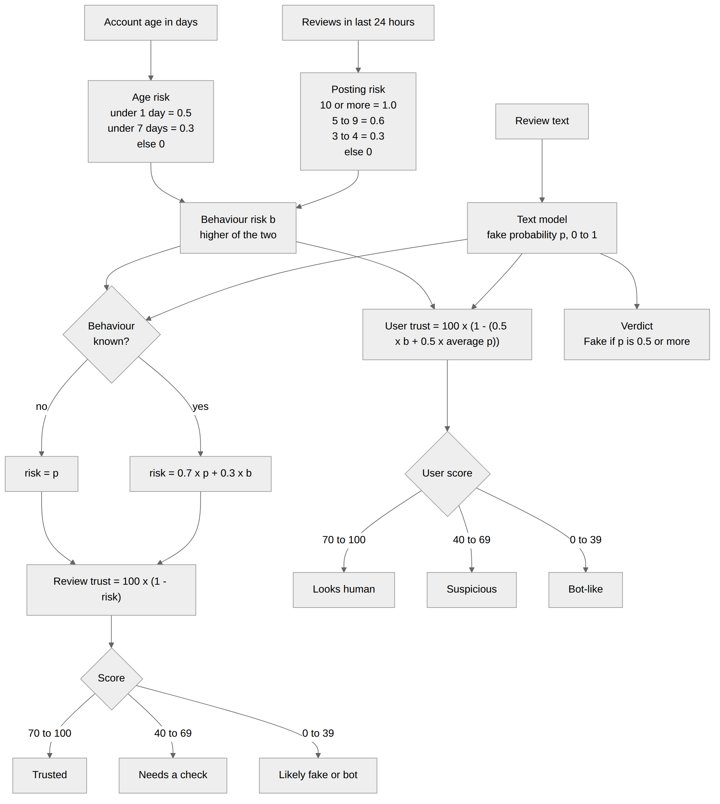

# 5. Trust Score, Bot Detection and Explanation Design



## 5.1 Behaviour risk (0 to 1)
Two clues are turned into a risk. The **higher** of the two is used.

| Clue | Value | Risk |
|---|---|---|
| Reviews in the last 24 hours | 10 or more | 1.0 |
| | 5 to 9 | 0.6 |
| | 3 to 4 | 0.3 |
| | 0 to 2 | 0 |
| Account age | under 1 day | 0.5 |
| | 1 to 6 days | 0.3 |
| | 7 days or more | 0 |

Where the numbers come from (no database): typed by the user (single review) or counted from `user_id` and `date` (CSV). In CSV mode without a `date` column, the number of reviews a user has in the file is used instead, and account age is treated as unknown.

## 5.2 Review trust score
```
text risk  p = fake probability from the best model (0 to 1)
behaviour  b = behaviour risk (0 to 1), or unknown

if b is known:  risk = 0.7 x p + 0.3 x b
else:           risk = p

review trust = round( 100 x (1 - risk) )
```
| Score | Level |
|---|---|
| 70 to 100 | Trusted |
| 40 to 69 | Needs a check |
| 0 to 39 | Likely fake or bot |

**Verdict:** Fake if p is 0.5 or more, otherwise Genuine (text only).

## 5.3 User trust score and bot status
```
user trust = round( 100 x (1 - (0.5 x b + 0.5 x average p of the user's reviews)) )
```
| Score | Bot status |
|---|---|
| 70 to 100 | Looks human |
| 40 to 69 | Suspicious |
| 0 to 39 | Bot-like |

## 5.4 Worked examples
**Example 1 (from the project review slide).** p = 0.60, 6 reviews today, account 3 days old.
Posting risk 0.6, age risk 0.3, so b = 0.6. Risk = 0.7 x 0.60 + 0.3 x 0.6 = 0.60. Trust = 40, level **Needs a check**.

**Example 2 (bot-like user).** A user posts 14 reviews in one day, and the average fake probability of those reviews is 0.90.
b = 1.0. User trust = 100 x (1 - (0.5 x 1.0 + 0.5 x 0.90)) = 5, status **Bot-like**.

## 5.5 Why these weights?
Text is the stronger clue, so it gets 70 percent in the review score. A user is judged half by how they act and half by what they write, so the user score uses 50/50. These values are **design choices**. The dataset has no user data, so they cannot be learned from it. Learning them from real reviewer data is future work.

## 5.6 Explanation design
Logistic Regression gives each word (or word pair) one weight: positive pushes toward **fake**, negative toward **real**.

```
contribution of a word = TF-IDF value of the word in this review x its weight
```
| Output | How it is made |
|---|---|
| "Why?" list | Top fake-like and real-like words, plus behaviour reasons. |
| Bar chart | The 8 words with the biggest absolute contribution. |
| Highlighted review | Each word of the original review is looked up. Fake-like words are shaded red, real-like words green. A stronger weight gives a darker shade. Single words only. |
| Score breakdown | The formula with the real numbers filled in. |

The explanation always comes from Logistic Regression, even when another model wins, because it gives one readable weight per word.

**Limit.** Fake and real reviews can use similar words, so highlighted words are a hint about what the model used, not proof that a review is fake.
