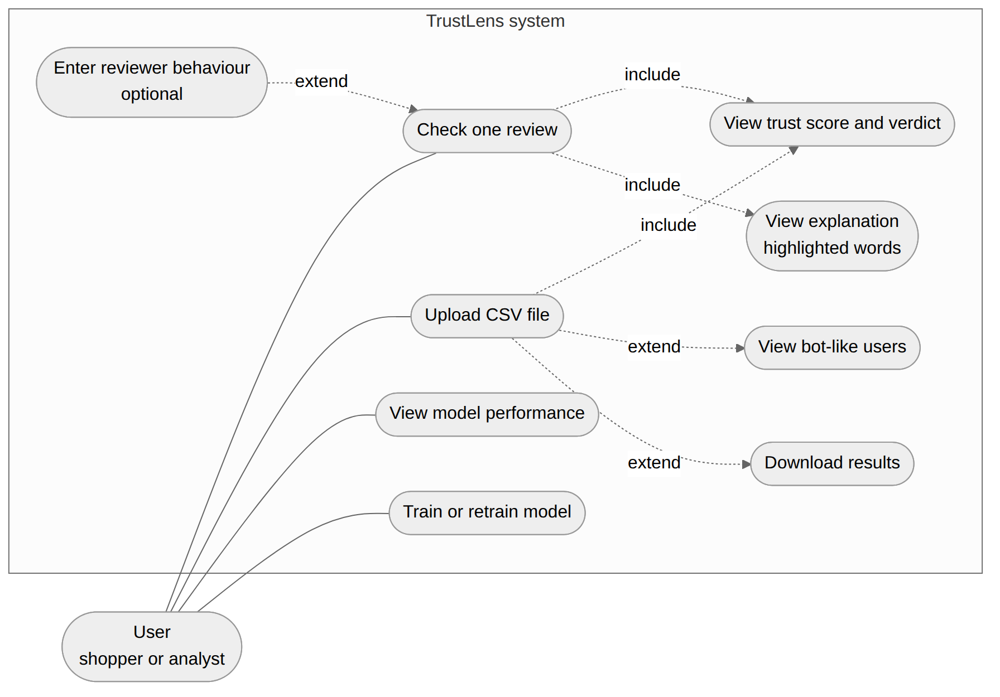
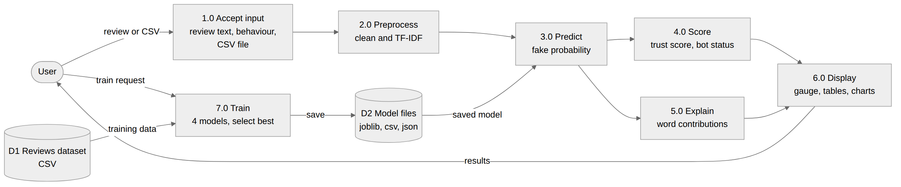
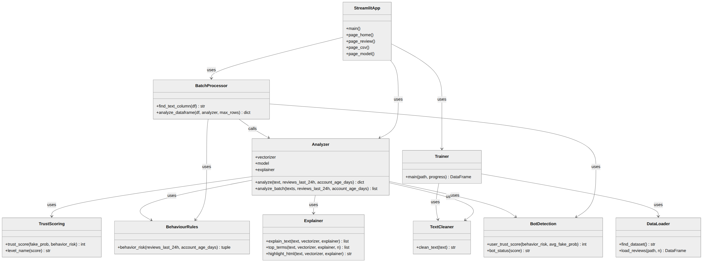
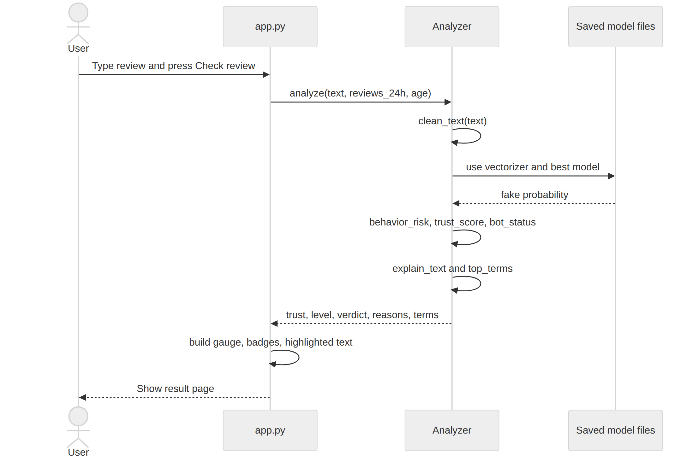
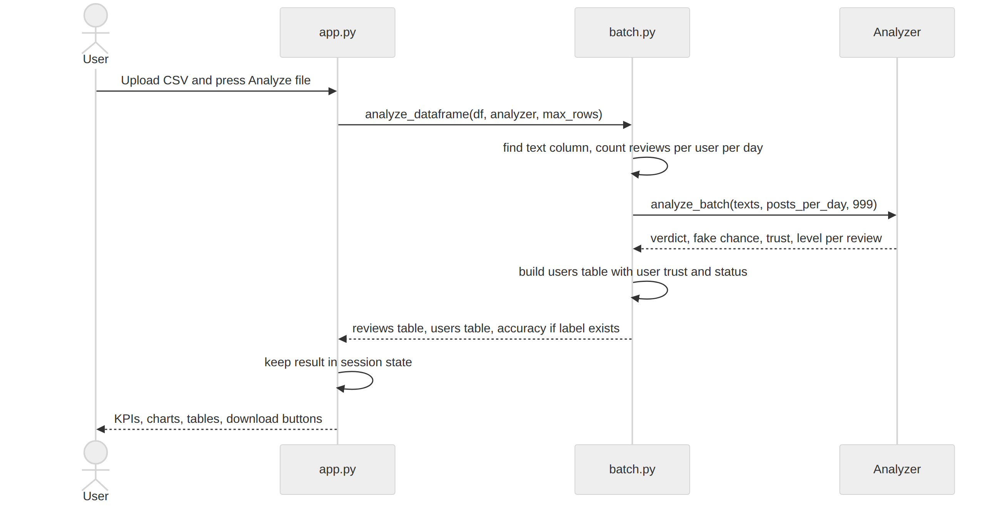
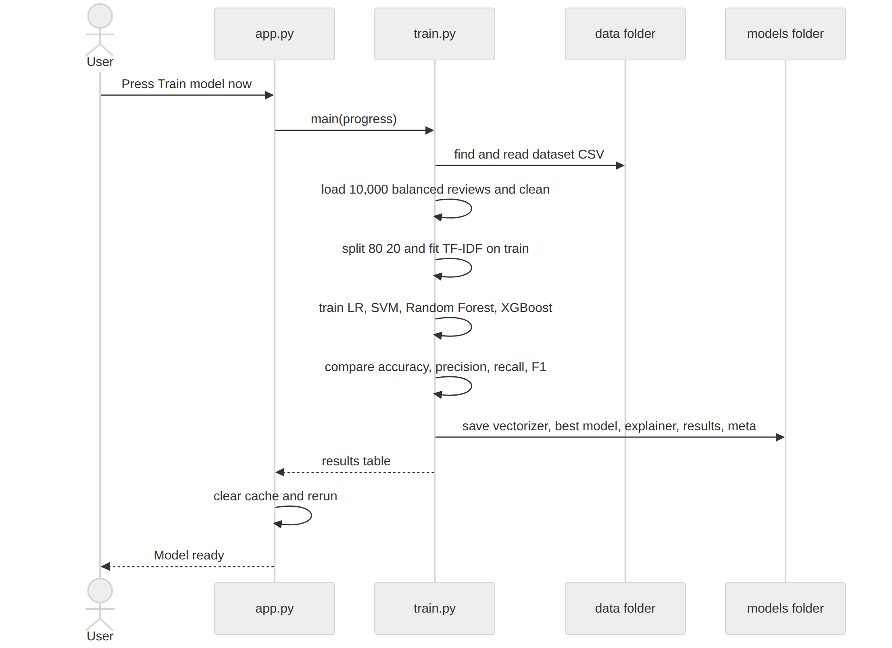

# 6. UML Diagrams and Data Flow

All diagrams are in the `diagrams/` folder. The editable Mermaid sources are in `diagrams/src/`.

## 6.1 Use case diagram

## 6.2 Data flow diagram

| Process | Input | Output |
|---|---|---|
| 1.0 Accept input | Review text, behaviour numbers or CSV file | Raw review(s) |
| 2.0 Preprocess | Raw review(s) | Cleaned text as TF-IDF numbers |
| 3.0 Predict | TF-IDF numbers, saved model (D2) | Fake probability |
| 4.0 Score | Fake probability, behaviour risk | Trust score, level, user trust, bot status |
| 5.0 Explain | TF-IDF numbers, explainer weights (D2) | Reasons, top words, highlighted text |
| 6.0 Display | Scores and explanations | Gauge, tables, charts, downloads |
| 7.0 Train | Reviews dataset (D1) | Model files saved to D2 |

## 6.3 Class diagram
The code is mostly small functions in modules. They are shown as classes to describe responsibilities. `Analyzer` is the only real class.

## 6.4 Sequence diagrams

### Check one review

### Check a CSV file

### Train the model

