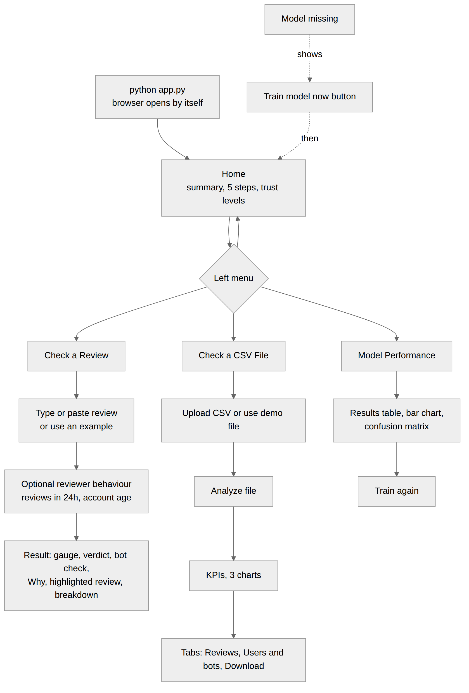

# 7. User Interface Design

The website is built with Streamlit. A left menu switches between four pages. All colours also have text labels, so meaning is never shown by colour alone.



## 7.1 Design principles
| Principle | How |
|---|---|
| Simple language | No jargon in labels; every score has a reason. |
| One clear result | A big gauge from 0 to 100, plus a text badge. |
| Colour with text | Green = good, amber = check, red = bad, always with a word (Trusted, Needs a check, Likely fake or bot). |
| Works in light and dark | Cards use semi-transparent backgrounds; Plotly charts follow the Streamlit theme. |
| Friendly errors | A missing model shows a **Train model now** button, not an error. |

## 7.2 Colour and status conventions
| Meaning | Colour | Text |
|---|---|---|
| Trusted, Genuine, Looks human | Green | 70 to 100 |
| Needs a check, Suspicious | Amber | 40 to 69 |
| Likely fake or bot, Fake, Bot-like | Red | 0 to 39 |

## 7.3 Page wireframes

### Left menu (all pages)
```
+------------------------+
| TrustLens              |
| Fake review, bot       |
| detection and user     |
| trust analysis         |
|  ( ) Home              |
|  ( ) Check a Review    |
|  ( ) Check a CSV File  |
|  ( ) Model Performance |
+------------------------+
```

### Home
```
+---------------------------------------------------------------+
| [ Hero banner ]  TrustLens                                    |
|  AI-based fake review detection, bot detection and trust score|
+---------------------------------------------------------------+
| Best model | F1 score | Accuracy | Reviews used     (metrics)  |
+---------------------------------------------------------------+
| How a review is checked                                       |
| [1 Clean] [2 Numbers] [3 Model] [4 Behaviour] [5 Score+Why]  |
+---------------------------------------------------------------+
| What you can do (two columns)                                 |
+---------------------------------------------------------------+
| Trust levels:  [Trusted] [Needs a check] [Likely fake or bot] |
+---------------------------------------------------------------+
```

### Check a Review
```
+---------------------------------------------------------------+
| Check a Review                                                |
| [Try a fake-style example] [Try a real-style example]         |
| +-----------------------------------------------------------+ |
| | Review text ...                                           | |
| +-----------------------------------------------------------+ |
| > Reviewer behaviour (optional) - turns on bot detection      |
|     [ ] I know how this reviewer behaves                      |
|     Reviews in last 24 hours [--o------]  Account age [--o--] |
| [ Check review ]                                              |
+---------------------------------------------------------------+
| Result                                                        |
|  ( gauge 0-100 )      Text verdict: [Fake]                    |
|                       Trust level:  [Likely fake or bot]      |
|                       Chance the text is fake: 96%            |
|  Bot detection: User trust 22 / 100  [Bot-like]  (if behaviour|
|                                                  is given)    |
|  [Why this score] [Highlighted review] [Score breakdown]      |
+---------------------------------------------------------------+
```
| Tab | Content |
|---|---|
| Why this score | Reasons list and a bar chart of the words that pushed the decision |
| Highlighted review | The review with red (fake-like) and green (real-like) words |
| Score breakdown | The formula with real numbers and the weights |

### Check a CSV File
```
+---------------------------------------------------------------+
| Check a CSV File                                              |
| [ Upload a CSV file ........ ] [Use the demo file] [Download] |
| Maximum reviews to check [----o-------]                       |
| [ Analyze file ]                                              |
+---------------------------------------------------------------+
| Reviews | Genuine | Fake | Average trust | Bot-like users       |
+---------------------------------------------------------------+
| [ Pie: genuine vs fake ] [ Histogram: trust ] [ Bar: levels ] |
+---------------------------------------------------------------+
| [Reviews] [Users and bots] [Download]                         |
|  Reviews:  filter by level, search text, table with trust bar |
|  Users:    most suspicious first (needs user_id column)       |
|  Download: review results and user results as CSV              |
+---------------------------------------------------------------+
```

### Model Performance
```
+---------------------------------------------------------------+
| Model Performance                                             |
| Trained on N reviews (train / test). Best model by F1: ...    |
| +------------------------------------------------------+      |
| | Model | Accuracy | Precision | Recall | F1            |      |
| +------------------------------------------------------+      |
| [ Grouped bar chart ]            [ Confusion matrix ]         |
| > Train again (upload dataset, press Train model now)         |
+---------------------------------------------------------------+
```

### Model missing (shown instead of the result)
```
+---------------------------------------------------------------+
| ! The model is not trained yet. Train it once here.           |
| Dataset found: data/fake reviews dataset.csv                  |
| [ Upload the dataset CSV ]                                    |
| [ Train model now ]   progress bar ........                   |
+---------------------------------------------------------------+
```

## 7.4 Input and output summary
| Page | Inputs | Outputs |
|---|---|---|
| Check a Review | Review text, optional behaviour (2 sliders) | Gauge, verdict, level, bot check, reasons, chart, highlighted review, breakdown |
| Check a CSV File | CSV file or demo file, maximum rows | KPIs, 3 charts, review table, users table, 2 downloads |
| Model Performance | Optional dataset upload | Results table, bar chart, confusion matrix |
